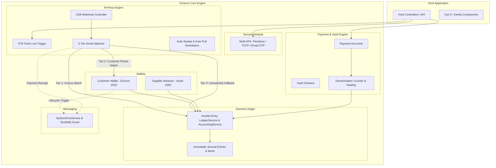

# Fortune Core (`ongudidan/fortune-core`)

[](https://packagist.org/packages/ongudidan/fortune-core)
[](https://github.com/ongudidan/fortune-core/actions)
[](https://packagist.org/packages/ongudidan/fortune-core)
[](LICENSE.md)

**Fortune Core** is the unified enterprise core suite for Fortune Devs. It consolidates production-tested financial, security, payment, and communication infrastructure into a modular, zero-bloat Laravel package.

Every module can be independently enabled or disabled via feature toggles in `config/fortune.php`.

---

## 📑 Table of Contents

- [Core Modules](#-core-modules)
- [System Architecture](#-system-architecture)
- [Installation & Setup](#-installation--setup)
- [Configuration & Feature Toggles](#-configuration--feature-toggles)
- [Database Migrations & Seeders](#-database-migrations--seeders)
- [Module In-Depth Documentation](#-module-in-depth-documentation)
  - [1. Security & Multi-2FA](#1-security--multi-2fa)
  - [2. Payments & Cash Vaults](#2-payments--cash-vaults)
  - [3. Customer & Supplier Wallets](#3-customer--supplier-wallets)
  - [4. Inter-Account Transfers](#4-inter-account-transfers)
  - [5. M-Pesa Daraja Engine](#5-m-pesa-daraja-engine)
  - [6. Double-Entry General Ledger](#6-double-entry-general-ledger)
  - [7. Bulk & System Transactional SMS](#7-bulk--system-transactional-sms)
  - [8. Financial & Reconciliation Reports](#8-financial--reconciliation-reports)
- [Frontend Components (Vue 3 / Inertia)](#-frontend-components-vue-3--inertia)
- [Console Commands & Schedulers](#-console-commands--schedulers)
- [Testing](#-testing)
- [🤖 AI Agent Master Integration Prompt](#-ai-agent-master-integration-prompt)
- [License](#-license)

---

## 🧩 Core Modules

| Module | Purpose | Default GL / Settings |
|---|---|---|
| **Security & Multi-2FA** | WebAuthn Passkeys, TOTP Authenticator, Email OTP | Integrates `ongudidan/laravel-multi-2fa` |
| **Payments & Cash Vaults** | Payment accounts, cash drawers, physical denominations & healing | `1001` (Cash), `1010` (Bank) |
| **Customer & Supplier Wallets** | Customer pre-payments & supplier advance tracking | `2015` (Customer Escrow), `1050` (Supplier Advance) |
| **Inter-Account Transfers** | Maker-checker transfers, fee allocation, idempotency healing | `6000` (Transaction Charges) |
| **M-Pesa Daraja Engine** | Live STK Push, C2B webhooks, 3-tier matching, auto-sweeps, auto-pulls | `1020` (Till), `1030` (Paybill), `2016` (Suspense) |
| **Double-Entry General Ledger** | Exact mathematical equality (`debits === credits`), immutable audit trail | Enforced double-entry ledger |
| **Bulk & System SMS** | TextSMS gateway, automated lifecycle triggers, balance query | SMS campaigns, delivery callbacks |
| **Financial Reports** | Anomaly audit, suspense statements, vault audit, trial balance, P&L | 10 specialized reporting services |

---

## 🏛 System Architecture



---

## 📦 Installation & Setup

Require `ongudidan/fortune-core` via Composer:

```bash
composer require ongudidan/fortune-core
```

*(During local monorepo development, register it as a path repository in the root `composer.json`)*:

```json
"repositories": [
    {
        "type": "path",
        "url": "packages/ongudidan/fortune-core",
        "options": {
            "symlink": true
        }
    }
]
```

### Publish Config & Migrations

```bash
# Publish configuration
php artisan vendor:publish --tag=fortune-config

# Publish database migrations
php artisan vendor:publish --tag=fortune-migrations

# Publish frontend Vue 3 components (optional)
php artisan vendor:publish --tag=fortune-vue

# Run database migrations
php artisan migrate
```

### Seed Initial Chart of Accounts, Denominations & SMS Templates

```bash
php artisan db:seed --class="Ongudidan\FortuneCore\Database\Seeders\ChartOfAccountsSeeder"
php artisan db:seed --class="Ongudidan\FortuneCore\Database\Seeders\CashDenominationsSeeder"
php artisan db:seed --class="Ongudidan\FortuneCore\Database\Seeders\SystemSmsTemplatesSeeder"
```

---

## ⚙ Configuration & Feature Toggles

The `config/fortune.php` configuration file allows total control over enabled modules and custom model bindings:

```php
return [
    'table_prefix' => env('FORTUNE_TABLE_PREFIX', 'fc_'),

    // Modular Feature Toggles (Disable any module with zero runtime overhead)
    'modules' => [
        'security_2fa' => env('FORTUNE_MODULE_SECURITY_2FA', true),
        'payments'     => env('FORTUNE_MODULE_PAYMENTS', true),
        'wallets'      => env('FORTUNE_MODULE_WALLETS', true),
        'transfers'    => env('FORTUNE_MODULE_TRANSFERS', true),
        'mpesa'        => env('FORTUNE_MODULE_MPESA', true),
        'ledger'       => env('FORTUNE_MODULE_LEDGER', true),
        'sms'          => env('FORTUNE_MODULE_SMS', true),
        'reports'      => env('FORTUNE_MODULE_REPORTS', true),
    ],

    // Model Registry (Overrides for custom host models)
    'models' => [
        'user'     => env('FORTUNE_USER_MODEL', 'App\\Models\\User'),
        'customer' => env('FORTUNE_CUSTOMER_MODEL', 'App\\Models\\Customer'),
        'supplier' => env('FORTUNE_SUPPLIER_MODEL', 'App\\Models\\Supplier'),
        'sale'     => env('FORTUNE_SALE_MODEL', 'App\\Models\\Sale'),
        'purchase' => env('FORTUNE_PURCHASE_MODEL', 'App\\Models\\Purchase'),
        'company'  => env('FORTUNE_COMPANY_MODEL', 'App\\Models\\Company'),
        'branch'   => env('FORTUNE_BRANCH_MODEL', 'App\\Models\\Branch'),
    ],

    // Chart of Accounts Code Map
    'accounts' => [
        'cash_in_hand'         => '1001',
        'bank_operating'       => '1010',
        'mpesa_till'           => '1020',
        'mpesa_paybill'        => '1030',
        'supplier_advances'    => '1050',
        'accounts_receivable'  => '1200',
        'accounts_payable'     => '2000',
        'customer_wallet'      => '2015',
        'unallocated_suspense' => '2016',
        'sales_revenue'        => '4000',
        'transaction_charges'  => '6000',
    ],
];
```

---

## 🗄 Database Migrations & Seeders

All migrations use the configurable table prefix (`fc_` by default):

1. `2026_01_01_000001_create_fortune_chart_of_accounts_table.php`: Chart of accounts (`fc_chart_of_accounts`)
2. `2026_01_01_000002_create_fortune_payment_accounts_table.php`: Payment accounts (`fc_payment_accounts`)
3. `2026_01_01_000003_create_fortune_denominations_tables.php`: Cash vault denominations (`fc_cash_denominations`, `fc_payment_account_denominations`)
4. `2026_01_01_000004_create_fortune_cash_drawers_tables.php`: Cash drawers, shifts, drawer transactions, floats
5. `2026_01_01_000005_create_fortune_mpesa_tables.php`: M-Pesa configurations & transaction logs (`fc_mpesa_configs`, `fc_mpesa_transactions`)
6. `2026_01_01_000006_create_fortune_mpesa_automation_tables.php`: Auto-sweeps and auto-pull schedules
7. `2026_01_01_000007_create_fortune_ledger_tables.php`: Double-entry journals & items (`fc_journal_entries`, `fc_journal_items`)
8. `2026_01_01_000008_create_fortune_wallets_tables.php`: Customer wallets, supplier advances, entity ledger
9. `2026_01_01_000009_create_fortune_sms_tables.php`: SMS configurations, templates, campaigns, logs

---

## 🔍 Module In-Depth Documentation

### 1. Security & Multi-2FA
Directly integrates `ongudidan/laravel-multi-2fa`. Provides WebAuthn Passkeys, TOTP Authenticator apps (Google Authenticator, Microsoft Authenticator), and Email OTP challenge modals.

### 2. Payments & Cash Vaults
- **Denomination Healing**:
  Compares physical cash denomination counts (`SUM(denomination * quantity)`) with the ledger balance and records reconciliation adjustments.

```php
use Ongudidan\FortuneCore\Modules\Payments\Services\PaymentAccountService;

$service = app(PaymentAccountService::class);
$result = $service->healDenominationBalance($vaultAccount);

if ($result['is_reconciled']) {
    // Vault matches physical drawer count exactly
} else {
    // Discrepancy detected: $result['status'] ('overage' or 'shortage')
    // Discrepancy amount: $result['discrepancy']
}
```

- **Cheque Payout Clearance**:
  Defers GL balance deductions and journal entries until a physical collector is assigned and the bank reference clears.

```php
use Ongudidan\FortuneCore\Modules\Payments\Services\ChequeClearanceService;

$chequeService = app(ChequeClearanceService::class);

// Step 1: Assign collector (no GL entries yet)
$chequeService->assignCollector($chequeId, 'John Doe', 'ID-123456');

// Step 2: Clear cheque with bank transaction reference
$chequeService->clearCheque($chequeId, 'BANK-REF-998822');
```

### 3. Customer & Supplier Wallets
- **Customer Escrow (GL 2015)**: Records customer deposits and wallet usage.
- **Supplier Advances (GL 1050)**: Records supplier prepayments and offsets against bills.

```php
use Ongudidan\FortuneCore\Modules\Wallets\Services\WalletService;

$walletService = app(WalletService::class);

// Credit customer wallet with KES 5,000 from M-Pesa Till
$walletService->creditCustomerWallet(
    customerId: 42,
    amount: 5000.00,
    paymentAccountId: $tillAccountId,
    reference: 'MPESA-REF-123'
);

// Check running wallet balance
$balance = $walletService->getCustomerBalance(42); // 5000.00
```

### 4. Inter-Account Transfers
Provides maker-checker approvals, automated fee booking (`GL 6000`), and idempotency checks to prevent duplicate transfers.

```php
use Ongudidan\FortuneCore\Modules\Transfers\Services\PaymentAccountTransferService;

$transferService = app(PaymentAccountTransferService::class);

// Step 1: Initiate transfer from Cash Vault to Bank
$transfer = $transferService->initiateTransfer([
    'from_account_id' => $vaultId,
    'to_account_id' => $bankId,
    'amount' => 150000.00,
    'transfer_fee' => 150.00,
    'reference' => 'TX-2026-001',
]);

// Step 2: Approve transfer (posts double-entry GL items atomically)
$transferService->approveTransfer($transfer->id);
```

### 5. M-Pesa Daraja Engine
- **Live STK Push**: Triggers instant Daraja push to customer mobile phone.
- **C2B Webhook Confirmation**: 3-Tier automatic reconciliation:
  1. **Tier 1 (Exact Invoice Match)**: Settles invoice directly.
  2. **Tier 2 (Customer Phone Match)**: Credits customer wallet (`GL 2015`).
  3. **Tier 3 (Suspense Fallback)**: Credits Unallocated Suspense (`GL 2016`).
- **Auto-Sweep**: Scheduled sweeps from Till/Paybill to corporate bank account.
- **Auto-Pull**: Scheduled pulls from Daraja API for missed webhook reconciliation.

### 6. Double-Entry General Ledger
Guarantees mathematical equality (`sum(debits) === sum(credits)`). Throws `UnbalancedJournalException` if unbalanced.

```php
use Ongudidan\FortuneCore\Modules\Ledger\Services\AccountingService;

$accounting = app(AccountingService::class);

$entry = $accounting->postJournalEntry([
    'entry_date' => now()->toDateString(),
    'reference' => 'POS-SALE-001',
    'description' => 'Retail Cash Sale',
    'items' => [
        ['account_code' => '1001', 'debit' => 2500.00, 'credit' => 0.00, 'description' => 'Cash in Hand'],
        ['account_code' => '4000', 'debit' => 0.00, 'credit' => 2500.00, 'description' => 'Sales Revenue'],
    ],
]);
```

### 7. Bulk & System Transactional SMS
- **TextSMS Driver**: Integrated with TextSMS API.
- **Automated Lifecycle Hooks**: Automatically sends transactional SMS on M-Pesa payment reception and wallet top-ups.
- **Dynamic Variable Substitution**: Replaces `{customer_name}`, `{amount}`, `{reference}`, `{balance}` dynamically.

```php
use Ongudidan\FortuneCore\Modules\Sms\Services\SmsService;

$sms = app(SmsService::class);

$sms->sendSingle(
    phone: '254712345678',
    message: 'Dear Alice, your payment of KES 5,000 has been received.',
    templateSlug: 'payment_received'
);
```

### 8. Financial & Reconciliation Reports
- `GeneralLedgerReportService`
- `TrialBalanceReportService`
- `BalanceSheetReportService`
- `IncomeStatementReportService`
- `UnallocatedSuspenseReportService`
- `VaultAuditReportService`
- `CashDrawerReconciliationReportService`
- `InterAccountTransferAuditService`
- `SellPaymentReportService`
- `FinancialSummaryReportService`

---

## 🎨 Frontend Components (Vue 3 / Inertia)

The package bundles modern Tailwind CSS Vue 3 components in `resources/js/Components/`:

- `TwoFactorChallengeModal.vue`: Authenticator TOTP & Email OTP prompt
- `PasskeyManager.vue`: WebAuthn Passkeys registration & management
- `MpesaPaymentModal.vue`: Interactive Daraja STK Push modal with countdown timer
- `DenominationCounter.vue`: Physical cash counting grid with real-time discrepancy calculation
- `AccountTransferModal.vue`: Inter-account transfer composer with fee allocation
- `SingleSmsComposeModal.vue`: Quick SMS modal with character count & GSM segment calculation
- `SmsTemplateModal.vue`: SMS template editor with live variable tags
- `BulkSmsDashboard.vue`: Campaign manager, delivery metrics, and provider balance widget
- `UnallocatedPaymentsTable.vue`: M-Pesa Tier 3 suspense resolution interface
- `SearchableSelect.vue`: Accessible, searchable select dropdown (strictly adheres to the project standard ban on raw `<select>` tags)

---

## ⏰ Console Commands & Schedulers

Register the following commands in your application's `routes/console.php` or `app/Console/Kernel.php`:

```php
use Illuminate\Support\Facades\Schedule;

// Pull missed M-Pesa transactions every 15 minutes
Schedule::command('mpesa:auto-pull')->everyFifteenMinutes();

// Execute daily auto-sweep to main bank account at 23:00
Schedule::command('mpesa:auto-sweep')->dailyAt('23:00');

// Process scheduled SMS campaigns
Schedule::command('sms:process-campaigns')->everyMinute();

// Update SMS delivery reports from provider
Schedule::command('sms:update-delivery-status')->everyTenMinutes();
```

---

## 🧪 Testing

The package includes a comprehensive PHPUnit test suite covering double-entry integrity, denomination healing, 3-tier M-Pesa matching, and SMS templating:

```bash
composer test
# or
./vendor/bin/phpunit
```

Format code with Laravel Pint:

```bash
./vendor/bin/pint
```

---

## 🤖 AI Agent Master Integration Prompt

Copy and paste this prompt when instructing an AI agent to integrate **`ongudidan/fortune-core`** into any Laravel project:

```markdown
# TASK: Integrate `ongudidan/fortune-core` into this Laravel Application

You are tasked with integrating the official Fortune Devs unified enterprise engine:
`ongudidan/fortune-core`

## 1. COMPOSER SETUP
Install the package via Composer:
```bash
composer require ongudidan/fortune-core
```

## 2. PUBLISH & MIGRATE
Publish package assets and run migrations:
```bash
php artisan vendor:publish --tag=fortune-config
php artisan vendor:publish --tag=fortune-migrations
php artisan migrate
php artisan db:seed --class="Ongudidan\FortuneCore\Database\Seeders\ChartOfAccountsSeeder"
php artisan db:seed --class="Ongudidan\FortuneCore\Database\Seeders\CashDenominationsSeeder"
php artisan db:seed --class="Ongudidan\FortuneCore\Database\Seeders\SystemSmsTemplatesSeeder"
```

## 3. CONFIGURE FEATURE TOGGLES & MODELS
In `config/fortune.php`:
1. Verify which modules to enable (`security_2fa`, `payments`, `wallets`, `transfers`, `mpesa`, `ledger`, `sms`, `reports`).
2. Map host models:
   - `'user' => App\Models\User::class`
   - `'customer' => App\Models\Customer::class`
   - `'supplier' => App\Models\Supplier::class`
   - `'sale' => App\Models\Sale::class`

## 4. UI RULES & FRONTEND COMPLIANCE
- **SearchableSelect**: Never use native `<select>` tags. Always use `SearchableSelect.vue`.
- **Axios Ban**: Never use `axios`. Use Inertia `router`, `useForm`, or standard browser `fetch`.
- **Cheque Clearance**: Never deduct balance or post GL entries until a collector is assigned and the cheque clears with a bank reference.

## 5. SCHEDULER WIRING
In `routes/console.php`:
- Schedule `mpesa:auto-pull` every 15 minutes.
- Schedule `mpesa:auto-sweep` daily.
- Schedule `sms:process-campaigns` every minute.
- Schedule `sms:update-delivery-status` every 10 minutes.
```

---

## 📄 License

The MIT License (MIT). Please see [License File](LICENSE.md) for more information.
