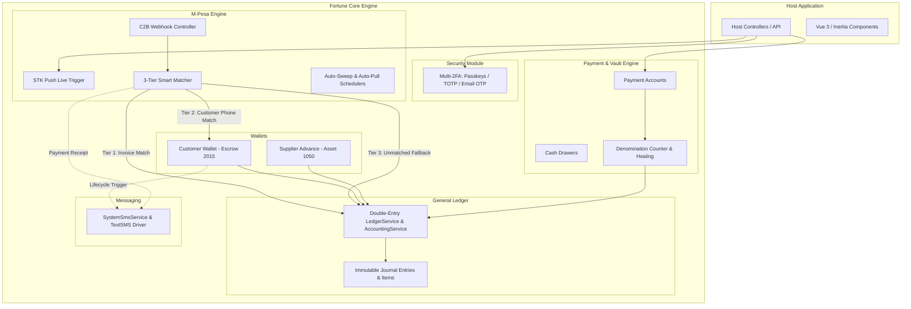

# Fortune Core (`ongudidan/fortune-core`)

[](https://packagist.org/packages/ongudidan/fortune-core)
[](https://github.com/ongudidan/fortune-core/actions)
[](https://packagist.org/packages/ongudidan/fortune-core)
[](LICENSE.md)

**Fortune Core** is the unified enterprise core suite for Fortune Devs. It consolidates production-tested financial, security, payment, and communication infrastructure into a modular, zero-bloat Laravel package.

Every module can be independently enabled or disabled via feature toggles in `config/fortune.php`.

---

## 📑 Table of Contents

- [Core Modules](#-core-modules)
- [System Architecture](#-system-architecture)
- [Installation & Setup](#-installation--setup)
- [Configuration & Feature Toggles](#-configuration--feature-toggles)
- [Database Migrations & Seeders](#-database-migrations--seeders)
- [Module In-Depth Documentation & How-To-Use Guides](#-module-in-depth-documentation--how-to-use-guides)
  - [1. Security & Multi-2FA](#1-security--multi-2fa)
  - [2. Payments, Cash Drawers & Cash Vaults](#2-payments-cash-drawers--cash-vaults)
  - [3. Customer & Supplier Wallets](#3-customer--supplier-wallets)
  - [4. Inter-Account Transfers & Maker-Checker](#4-inter-account-transfers--maker-checker)
  - [5. M-Pesa Daraja Automation Engine](#5-m-pesa-daraja-automation-engine)
  - [6. Double-Entry General Ledger](#6-double-entry-general-ledger)
  - [7. Bulk & System Transactional SMS](#7-bulk--system-transactional-sms)
  - [8. Financial & Reconciliation Reports](#8-financial--reconciliation-reports)
  - [9. Wholesale & FMCG Inventory Engine](#9-wholesale--fmcg-inventory-engine)
  - [10. Frontend Vue 3 / Inertia Components Integration](#10-frontend-vue-3--inertia-components-integration)
- [Frontend Components (Vue 3 / Inertia)](#-frontend-components-vue-3--inertia)
- [Console Commands & Schedulers](#-console-commands--schedulers)
- [Testing](#-testing)
- [🤖 AI Agent Master Integration Prompt](#-ai-agent-master-integration-prompt)
- [License](#-license)

---

## 🧩 Core Modules

| Module | Purpose | Default GL / Settings |
|---|---|---|
| **Security & Multi-2FA** | WebAuthn Passkeys, TOTP Authenticator, Email OTP | Integrates `ongudidan/laravel-multi-2fa` |
| **Payments & Cash Vaults** | Payment accounts, cash drawers, physical denominations & healing | `1001` (Cash), `1010` (Bank) |
| **Customer & Supplier Wallets** | Customer pre-payments & supplier advance tracking | `2015` (Customer Escrow), `1050` (Supplier Advance) |
| **Inter-Account Transfers** | Maker-checker transfers, fee allocation, idempotency healing | `6000` (Transaction Charges) |
| **M-Pesa Daraja Engine** | Live STK Push, C2B webhooks, 3-tier matching, auto-sweeps, auto-pulls | `1020` (Till), `1030` (Paybill), `2016` (Suspense) |
| **Double-Entry General Ledger** | Exact mathematical equality (`debits === credits`), immutable audit trail | Enforced double-entry ledger |
| **Bulk & System SMS** | TextSMS gateway, automated lifecycle triggers, balance query | SMS campaigns, delivery callbacks |
| **Financial Reports** | Anomaly audit, suspense statements, vault audit, trial balance, P&L | 10 specialized reporting services |
| **Wholesale Inventory** | Multi-unit conversion, FIFO batching, empty containers, stock-taking, GL linkage | `1300` (Asset), `5000` (COGS), `5500` (Shrinkage), `2050` (GRNI) |
| **Sales & POS Checkout** | Multi-tender checkout (Cash, M-Pesa, Wallet), stock relief, empty yield, returns | `4000` (Revenue), `1200` (AR), `1001` (Cash), `1020` (M-Pesa) |
| **Purchases & Procurement** | Purchase orders, GRN batch intake, AP settlement, supplier advance offset | `1300` (Asset), `2050` (GRNI), `1050` (Advances), `1010` (Bank) |
| **Inventory Cost Adjustments** | Valuation revaluation on stock on hand, average cost & batch sync, GL gain/loss | `1300` (Asset), `5500` (Inventory Adjustment Gain / Loss) |

---

## 🏛 System Architecture



---

## 📦 Installation & Setup

Require `ongudidan/fortune-core` via Composer:

```bash
composer require ongudidan/fortune-core
```

*(During local monorepo development, register it as a path repository in the root `composer.json`)*:

```json
"repositories": [
    {
        "type": "path",
        "url": "packages/ongudidan/fortune-core",
        "options": {
            "symlink": true
        }
    }
]
```

### Publish Config & Migrations

```bash
# Publish configuration
php artisan vendor:publish --tag=fortune-config

# Publish database migrations
php artisan vendor:publish --tag=fortune-migrations

# Publish frontend Vue 3 components (optional)
php artisan vendor:publish --tag=fortune-vue

# Run database migrations
php artisan migrate
```

### Seed Initial Chart of Accounts, Denominations & SMS Templates

```bash
php artisan db:seed --class="Ongudidan\FortuneCore\Database\Seeders\ChartOfAccountsSeeder"
php artisan db:seed --class="Ongudidan\FortuneCore\Database\Seeders\CashDenominationsSeeder"
php artisan db:seed --class="Ongudidan\FortuneCore\Database\Seeders\SystemSmsTemplatesSeeder"
```

---

## ⚙ Configuration & Feature Toggles

The `config/fortune.php` configuration file allows total control over enabled modules and custom model bindings:

```php
return [
    'table_prefix' => env('FORTUNE_TABLE_PREFIX', 'fc_'),

    // Modular Feature Toggles (Disable any module with zero runtime overhead)
    'modules' => [
        'security_2fa' => env('FORTUNE_MODULE_SECURITY_2FA', true),
        'payments'     => env('FORTUNE_MODULE_PAYMENTS', true),
        'wallets'      => env('FORTUNE_MODULE_WALLETS', true),
        'transfers'    => env('FORTUNE_MODULE_TRANSFERS', true),
        'mpesa'        => env('FORTUNE_MODULE_MPESA', true),
        'ledger'       => env('FORTUNE_MODULE_LEDGER', true),
        'sms'          => env('FORTUNE_MODULE_SMS', true),
        'reports'      => env('FORTUNE_MODULE_REPORTS', true),
    ],

    // Model Registry (Overrides for custom host models)
    'models' => [
        'user'     => env('FORTUNE_USER_MODEL', 'App\\Models\\User'),
        'customer' => env('FORTUNE_CUSTOMER_MODEL', 'App\\Models\\Customer'),
        'supplier' => env('FORTUNE_SUPPLIER_MODEL', 'App\\Models\\Supplier'),
        'sale'     => env('FORTUNE_SALE_MODEL', 'App\\Models\\Sale'),
        'purchase' => env('FORTUNE_PURCHASE_MODEL', 'App\\Models\\Purchase'),
        'company'  => env('FORTUNE_COMPANY_MODEL', 'App\\Models\\Company'),
        'branch'   => env('FORTUNE_BRANCH_MODEL', 'App\\Models\\Branch'),
    ],

    // Chart of Accounts Code Map
    'accounts' => [
        'cash_in_hand'         => '1001',
        'bank_operating'       => '1010',
        'mpesa_till'           => '1020',
        'mpesa_paybill'        => '1030',
        'supplier_advances'    => '1050',
        'accounts_receivable'  => '1200',
        'accounts_payable'     => '2000',
        'customer_wallet'      => '2015',
        'unallocated_suspense' => '2016',
        'sales_revenue'        => '4000',
        'transaction_charges'  => '6000',
    ],
];
```

---

## 🗄 Database Migrations & Seeders

All migrations use the configurable table prefix (`fc_` by default):

1. `2026_01_01_000001_create_fortune_chart_of_accounts_table.php`: Chart of accounts (`fc_chart_of_accounts`)
2. `2026_01_01_000002_create_fortune_payment_accounts_table.php`: Payment accounts (`fc_payment_accounts`)
3. `2026_01_01_000003_create_fortune_denominations_tables.php`: Cash vault denominations (`fc_cash_denominations`, `fc_payment_account_denominations`)
4. `2026_01_01_000004_create_fortune_cash_drawers_tables.php`: Cash drawers, shifts, drawer transactions, floats
5. `2026_01_01_000005_create_fortune_mpesa_tables.php`: M-Pesa configurations & transaction logs (`fc_mpesa_configs`, `fc_mpesa_transactions`)
6. `2026_01_01_000006_create_fortune_mpesa_automation_tables.php`: Auto-sweeps and auto-pull schedules
7. `2026_01_01_000007_create_fortune_ledger_tables.php`: Double-entry journals & items (`fc_journal_entries`, `fc_journal_items`)
8. `2026_01_01_000008_create_fortune_wallets_tables.php`: Customer wallets, supplier advances, entity ledger
9. `2026_01_01_000009_create_fortune_sms_tables.php`: SMS configurations, templates, campaigns, logs
10. `2026_01_01_000010_create_fortune_inventory_catalog_tables.php`: Products, categories, brands, units, variations, packaging unit conversions (`fc_products`, `fc_product_unit_conversions`, etc.)
11. `2026_01_01_000011_create_fortune_inventory_stock_and_batches_tables.php`: Locations, stock balances, FIFO/AVCO batches, stock and cost movements (`fc_locations`, `fc_product_inventories`, `fc_inventory_batches`, `fc_inventory_stock_movements`, `fc_inventory_cost_movements`)
12. `2026_01_01_000012_create_fortune_inventory_transfers_and_requests_tables.php`: Inter-location stock requests, transfers, and reversals (`fc_stock_requests`, `fc_stock_transfers`, `fc_stock_transfer_reversals`)
13. `2026_01_01_000013_create_fortune_inventory_stock_taking_tables.php`: Periodic retail/wholesale physical stock taking, breakdown by packaging, adjustments, and write-offs (`fc_stock_takings`, `fc_stock_taking_items`, `fc_inventory_stock_adjustments`, `fc_inventory_write_offs`)
14. `2026_01_01_000014_create_fortune_inventory_empty_containers_tables.php`: Empty container yield movements, customer owed balances, and fractional yield accumulators (`fc_empty_container_movements`, `fc_outlet_partial_empties`)

---

## 🔍 Module In-Depth Documentation & How-To-Use Guides

Every module in **Fortune Core** is self-contained, enterprise-tested, and feature-toggled via `config('fortune.modules.*')`. Below are practical code examples and workflows for each module.

---

### 1. Security & Multi-2FA
Directly integrates [`ongudidan/laravel-multi-2fa`](https://packagist.org/packages/ongudidan/laravel-multi-2fa) to provide WebAuthn Passkeys (biometric/hardware keys), TOTP Authenticator apps (Google / Microsoft Authenticator), and Email OTP.

#### User Model Setup:
```php
use Illuminate\Foundation\Auth\User as Authenticatable;
use Ongudidan\Multi2fa\Traits\HasMulti2fa;

class User extends Authenticatable
{
    use HasMulti2fa;
}
```

#### Triggering 2FA Challenge on Login or Sensitive Operations:
```php
use Illuminate\Support\Facades\Auth;

// Inside login controller or checkout step
if (Auth::user()->hasTwoFactorEnabled()) {
    session()->put('2fa.prompt_required', true);
    return redirect()->route('two-factor.challenge');
}
```

#### In Inertia Vue 3 Pages:
```vue
<script setup lang="ts">
import TwoFactorChallengeModal from '@/components/fortune/TwoFactorChallengeModal.vue';
import PasskeyManager from '@/components/fortune/PasskeyManager.vue';
</script>

<template>
    <!-- Modal prompt when user logs in -->
    <TwoFactorChallengeModal :open="showChallengeModal" @success="onTwoFactorVerified" />

    <!-- Passkeys management tab in user profile -->
    <PasskeyManager :passkeys="userPasskeys" />
</template>
```

---

### 2. Payments, Cash Drawers & Cash Vaults
Manage physical vaults, petty cash drawers, bank accounts, and mobile till/paybill balances with real-time running balances and physical denomination reconciliation.

#### Creating a Payment Account:
```php
use Ongudidan\FortuneCore\Modules\Payments\Models\PaymentAccount;

$vault = PaymentAccount::create([
    'name' => 'Main Headquarter Vault',
    'type' => 'vault',
    'currency' => 'KES',
    'balance' => 250000.00,
    'has_denominations' => true,
    'is_active' => true,
]);
```

#### Cash Drawer Operations (Opening Float & Shift Close):
```php
use Ongudidan\FortuneCore\Modules\Payments\Services\CashDrawerService;

$drawerService = app(CashDrawerService::class);

// 1. Issue opening float from Vault to Cash Drawer 1
$session = $drawerService->openShift(
    drawerAccountId: $drawerId,
    cashierUserId: $cashierId,
    openingFloat: 5000.00,
    sourceVaultAccountId: $vaultId
);

// 2. Close shift and reconcile physical cash vs expected ledger sales
$reconciliation = $drawerService->closeShift(
    sessionId: $session->id,
    actualCashCounted: 48500.00,
    notes: 'Shift completed. Discrepancy: KES 0.00'
);
```

#### Vault Physical Denomination Healing (`healDenominationBalance`):
Cross-examines physical denomination note/coin counts (`SUM(denomination * quantity)`) against the account's ledger balance and flags overages or shortages:
```php
use Ongudidan\FortuneCore\Modules\Payments\Services\PaymentAccountService;

$paymentService = app(PaymentAccountService::class);

// Provide explicit physical note counts: [denomination_id => quantity]
$result = $paymentService->healDenominationBalance($vaultAccount, [
    1 => 50, // 50 notes of 1000 = 50,000
    2 => 40, // 40 notes of 500  = 20,000
]);

if ($result['is_reconciled']) {
    // Physical vault matches ledger balance perfectly
} else {
    // Discrepancy detected: $result['status'] ('shortage' or 'overage')
    // Difference: $result['discrepancy']
    // Automatically creates a pending PaymentAccountAdjustment record
}
```

#### Deferred Cheque Payout Life Cycle:
In compliance with accounting standards, cheques do **not** deduct bank balances or post GL entries until a collector is assigned and the cheque transaction clears with a bank reference.
```php
use Ongudidan\FortuneCore\Modules\Payments\Services\ChequeClearanceService;

$chequeService = app(ChequeClearanceService::class);

// Stage 1: Issue Cheque Transaction (status is 'pending', no GL postings yet)
$chequeTx = $chequeService->issueCheque([
    'payment_account_id' => $bankAccountId,
    'cheque_number' => 'CHQ-778899',
    'amount' => 120000.00,
    'payee_name' => 'Crown Paints Kenya PLC',
]);

// Stage 2: Assign physical cheque collector
$chequeService->assignCollector(
    chequeId: $chequeTx->id,
    collectorName: 'Peter Kamau',
    collectorIdNumber: '24119988'
);

// Stage 3: Bank clears cheque with transaction reference
// This step decrements the bank balance and posts double-entry GL items atomically
$chequeService->clearCheque(
    chequeId: $chequeTx->id,
    bankReference: 'EFT-NBO-882299'
);
```

---

### 3. Customer & Supplier Wallets
Track customer escrow prepayments (`GL 2015`) and supplier advance payments (`GL 1050`) with double-entry running balances.

#### Customer Wallet Top-Up (Escrow Liability 2015):
```php
use Ongudidan\FortuneCore\Modules\Wallets\Services\WalletService;

$walletService = app(WalletService::class);

// Customer deposits KES 10,000 into wallet via M-Pesa Till
$walletTx = $walletService->creditCustomerWallet(
    customerId: 15,
    amount: 10000.00,
    paymentAccountId: $tillAccountId,
    reference: 'QW99881122',
    description: 'Wallet advance top-up'
);

// Check current running wallet balance
$balance = $walletService->getCustomerBalance(15); // 10000.00
```

#### Deducting Customer Wallet at Checkout / Invoice Settlement:
```php
// Deduct KES 4,500 from customer wallet to settle sales invoice #1024
$walletService->debitCustomerWallet(
    customerId: 15,
    amount: 4500.00,
    reference: 'INV-1024',
    description: 'Payment for Invoice #1024'
);

$remaining = $walletService->getCustomerBalance(15); // 5500.00
```

#### Supplier Advance Prepayments (Asset 1050):
```php
// Advance KES 50,000 to supplier before goods arrival
$walletService->creditSupplierWallet(
    supplierId: 8,
    amount: 50000.00,
    paymentAccountId: $bankAccountId,
    reference: 'ADV-SUPP-008'
);

// Check supplier prepaid advance balance
$advBalance = $walletService->getSupplierBalance(8); // 50000.00
```

---

### 4. Inter-Account Transfers & Maker-Checker
Transfer money between internal accounts (Vault $\rightarrow$ Bank, Till $\rightarrow$ Bank) with automated fee booking to `GL 6000` (Transaction Charges) and maker-checker approval controls.

```php
use Ongudidan\FortuneCore\Modules\Transfers\Services\PaymentAccountTransferService;

$transferService = app(PaymentAccountTransferService::class);

// Step 1: Cashier initiates transfer from Vault to Bank
$transfer = $transferService->initiateTransfer([
    'from_account_id' => $vaultAccountId,
    'to_account_id' => $bankAccountId,
    'amount' => 150000.00,
    'transfer_fee' => 150.00,
    'reference' => 'CIT-SEC-9921',
    'notes' => 'CIT cash collection to Equity Bank',
]);

// Step 2: Financial controller reviews and approves
// Posts double-entry GL items atomically:
//   Debit Bank Account (1010) = 150,000
//   Debit Bank Charges (6000) = 150
//   Credit Vault Account (1001) = 150,150
$transferService->approveTransfer($transfer->id, approverUserId: auth()->id());
```

---

### 5. M-Pesa Daraja Automation Engine
Complete integration with Safaricom Daraja API for live STK Push, C2B webhooks with 3-tier intelligent reconciliation, auto-sweeps, and auto-pulls.

#### Live STK Push Prompt:
```php
use Ongudidan\FortuneCore\Modules\Mpesa\Services\MpesaTransactionService;

$mpesaService = app(MpesaTransactionService::class);

$response = $mpesaService->initiateStkPush(
    phone: '254712345678',
    amount: 1500.00,
    accountReference: 'INV-2048',
    transactionDesc: 'Payment for Invoice #2048'
);

if ($response['success']) {
    // STK prompt successfully delivered to customer phone
    $checkoutRequestId = $response['checkout_request_id'];
}
```

#### C2B Webhook Confirmation & 3-Tier Intelligent Matching:
When Safaricom sends a C2B confirmation webhook payload:
```php
// In your controller or WebhookController
$payload = $request->all();
$transaction = $mpesaService->handleC2bConfirmation($payload);
```
**The 3-Tier Reconciliation Algorithm executes atomically:**
1. **Tier 1 (Exact Invoice Match):**
   Matches `BillRefNumber` against unpaid invoices. If matched, settles invoice and marks transaction `allocated`.
2. **Tier 2 (Customer Phone Match):**
   If no invoice matches, matches `MSISDN` against customer telephone numbers. If matched, credits customer wallet (`GL 2015`) and marks transaction `allocated`.
3. **Tier 3 (Suspense Fallback):**
   If both fail, funds are safely credited to Unallocated Suspense (`GL 2016`), ready for manual resolution via `UnallocatedPaymentsTable.vue`.

#### Automated Schedulers:
In `routes/console.php` or `app/Console/Kernel.php`:
```php
use Illuminate\Support\Facades\Schedule;

// Pull missed transactions from Daraja every 15 minutes
Schedule::command('mpesa:auto-pull')->everyFifteenMinutes();

// Auto-sweep daily earnings from Paybill/Till to corporate bank at 23:00
Schedule::command('mpesa:auto-sweep')->dailyAt('23:00');
```

---

### 6. Double-Entry General Ledger
Guarantees mathematical equality ($\sum \text{Debits} \equiv \sum \text{Credits}$). If debits and credits do not balance, it immediately throws `UnbalancedJournalException`.

#### Posting Multi-Line Journal Entries:
```php
use Ongudidan\FortuneCore\Modules\Ledger\Services\AccountingService;

$accounting = app(AccountingService::class);

$entry = $accounting->postJournalEntry([
    'entry_date' => now()->toDateString(),
    'reference' => 'SAL-2026-001',
    'description' => 'Staff Salaries Payout',
    'items' => [
        [
            'account_code' => '5100', // Salary Expense
            'debit' => 450000.00,
            'credit' => 0.00,
            'description' => 'Gross salaries',
        ],
        [
            'account_code' => '1010', // Operating Bank Account
            'debit' => 0.00,
            'credit' => 450000.00,
            'description' => 'Direct bank transfer payout',
        ],
    ],
]);
```

#### Calculating Running Balances:
```php
use Ongudidan\FortuneCore\Modules\Ledger\Services\LedgerService;

$ledger = app(LedgerService::class);

$history = $ledger->getAccountLedger(accountCode: '1001', fromDate: '2026-01-01');
$currentBalance = $ledger->getRunningBalance(accountCode: '1001');
```

---

### 7. Bulk & System Transactional SMS
Send transactional SMS via TextSMS API gateway with automatic variable interpolation, scheduled campaigns, and delivery report tracking.

#### Sending a Single Transactional SMS:
```php
use Ongudidan\FortuneCore\Modules\Sms\Services\SmsService;

$sms = app(SmsService::class);

$sms->sendSingle(
    phone: '254711223344',
    message: 'Hello {customer_name}, your order #{order_no} has been dispatched.',
    variables: [
        'customer_name' => 'Alice Mwangi',
        'order_no' => 'ORD-9912',
    ]
);
```

#### Automated Cross-Module Hooks:
When enabled, SMS notifications fire automatically on:
- Customer wallet credit (notifies customer of top-up and new balance)
- M-Pesa transaction received
- Low stock threshold reached

#### Creating Scheduled Campaigns:
```php
$campaign = $sms->createCampaign([
    'name' => 'End of Month Wholesale Promo',
    'message' => 'Dear Customer, enjoy 5% discount on cooking oil bales this weekend!',
    'recipients' => ['254711223344', '254722334455', '254733445566'],
    'scheduled_at' => now()->addHours(2),
]);
```

---

### 8. Financial & Reconciliation Reports
Run 10 specialized financial statements and audit services directly:

```php
use Ongudidan\FortuneCore\Modules\Reports\Services\TrialBalanceReportService;
use Ongudidan\FortuneCore\Modules\Reports\Services\BalanceSheetReportService;
use Ongudidan\FortuneCore\Modules\Reports\Services\ProfitLossReportService;
use Ongudidan\FortuneCore\Modules\Reports\Services\VaultAuditReportService;

// 1. Trial Balance Statement
$trialBalance = app(TrialBalanceReportService::class)->generate(asOfDate: '2026-12-31');

// 2. Balance Sheet Statement
$balanceSheet = app(BalanceSheetReportService::class)->generate(asOfDate: '2026-12-31');

// 3. Profit & Loss Statement
$pnl = app(ProfitLossReportService::class)->generate(startDate: '2026-01-01', endDate: '2026-12-31');

// 4. Physical Vault Audit
$vaultAudit = app(VaultAuditReportService::class)->generate(vaultAccountId: $vaultId);
```

---

### 9. Wholesale & FMCG Inventory Engine
Complete inventory management with multi-tier packaging conversions, returnable containers, FIFO batch tracking, and automatic double-entry General Ledger linkages.

#### 1. Multi-Tier Packaging Conversion:
Define products sold in multiple packaging layers (Carton $\rightarrow$ Inner Pack $\rightarrow$ Piece):
```php
use Ongudidan\FortuneCore\Modules\Inventory\Services\InventoryService;

$inventoryService = app(InventoryService::class);

// Product #10 has Base Unit = Piece. Unit #5 = Carton of 24 pieces.
// Convert 3.5 cartons to loose pieces:
$pieces = $inventoryService->convertToBase(
    productId: 10,
    qty: 3.5,
    unitId: 5
); // 84.0 loose pieces
```

#### 2. Goods Receipt Note (GRN Purchases Intake & GL Posting):
Intakes stock, creates batch, updates running balance, and writes balanced GL journals:
```php
use Ongudidan\FortuneCore\Modules\Inventory\Services\StockMovementService;

$stockService = app(StockMovementService::class);

// Intakes 50 cartons at KES 2,400 per carton = KES 120,000
// Automatically writes balanced General Ledger journals:
//   Debit 1300 (Inventory Asset) = 120,000
//   Credit 2050 (GRNI Clearing / Accounts Payable) = 120,000
$stockService->applyPurchase(
    productId: 10,
    quantity: 50,
    unitCost: 2400.00,
    locationId: $warehouseId,
    reference: 'GRN-2026-004'
);
```

#### 3. Sales Deduction & COGS GL Posting:
Relieves stock, consumes FIFO batches, and books COGS:
```php
// Sells 10 cartons from retail store #1
// Automatically writes balanced General Ledger journals:
//   Debit 5000 (Cost of Goods Sold) = 24,000
//   Credit 1300 (Inventory Asset) = 24,000
$stockService->applySale(
    productId: 10,
    quantity: 10,
    locationId: $retailStoreId,
    reference: 'SALE-1049'
);
```

#### 4. Returnable Packaging & Empty Container Yield:
When beverages or gas cylinders are sold, empty crates and bottles yield into inventory while tracking customer liability:
```php
use Ongudidan\FortuneCore\Modules\Inventory\Services\EmptyContainerService;

$containerService = app(EmptyContainerService::class);

// Process empty bottle yield on sale of 10 sodas:
// - Accumulates fractional empty crates/bottles in fc_outlet_partial_empties
// - Records movement in fc_empty_container_movements
// - Increases physical empty container stock in the store
$yieldResult = $containerService->processSaleYield(
    locationId: $storeId,
    productId: $sodaId,
    variation: $variationModel,
    quantitySold: 10,
    customerId: 5
);

// Customer returns 8 empty bottles:
$containerService->recordCustomerReturn(
    customerId: 5,
    emptyProductId: $emptyBottleId,
    quantity: 8,
    locationId: $storeId
);

// Check remaining empty bottles customer owes:
$remainingDebt = $containerService->getCustomerContainerBalance(customerId: 5, emptyProductId: $emptyBottleId);
```

#### 5. Physical Stock-Taking with Carton/Piece Normalization:
Normalizes physical cartons and loose pieces, computes variance, and writes shrinkage/overage GL entries:
```php
use Ongudidan\FortuneCore\Modules\Inventory\Services\RetailStockTakingService;

$stockTakingService = app(RetailStockTakingService::class);

// Step 1: Normalize physical count (e.g., 4 cartons of 24 + 5 loose pieces = 101 pieces)
$normalizedCount = $stockTakingService->normalizeCounts(
    productId: 10,
    packages: 4,
    looseUnits: 5,
    packUnitId: 5 // Carton unit ID
);

// Step 2: Finalize stock-taking session:
// - Evaluates physical counts vs book system quantities
// - Records InventoryStockAdjustment records for variances
// - Automatically writes balanced General Ledger journals:
//     If Shortage: Debit 5500 (Shrinkage Expense), Credit 1300 (Inventory Asset)
//     If Overage:  Debit 1300 (Inventory Asset), Credit 5500 (Adjustment Gain)
$finalized = $stockTakingService->finalizeStockTaking(stockTakingId: 3);
```

#### 6. Inventory Spoilage / Breakage Write-Offs:
```php
use Ongudidan\FortuneCore\Modules\Inventory\Services\InventoryWriteOffService;

$writeOffService = app(InventoryWriteOffService::class);

// Write off 3 damaged cooking oil cartons (Debit 5500, Credit 1300)
$writeOff = $writeOffService->createWriteOff(
    locationId: $warehouseId,
    items: [
        ['product_id' => 10, 'quantity' => 3, 'unit_cost' => 2400.00]
    ],
    reason: 'breakage',
    notes: 'Damaged in transit by delivery truck'
);
```

#### 7. Wholesale / Retail Sales Checkout & Multi-Tender Settlements:
Handles complete checkout with multi-tender split payments (Cash, M-Pesa, Customer Escrow Wallet 2015), atomic FIFO stock relief, empty returnable container yield, and double-entry GL revenue posting:
```php
use Ongudidan\FortuneCore\Modules\Inventory\Services\SaleService;

$saleService = app(SaleService::class);

// Process wholesale/retail sale of 5 cartons @ KES 2,500 = KES 12,500
// Split payment: KES 7,500 Cash, KES 5,000 M-Pesa
$sale = $saleService->createSale([
    'location_id' => $storeId,
    'customer_id' => $customerId, // Optional
    'items' => [
        [
            'product_id' => $productId,
            'quantity' => 5,
            'unit_price' => 2500.00,
            'unit_cost' => 2000.00,
        ]
    ],
    'cash_paid' => 7500.00,
    'mpesa_paid' => 5000.00,
    'wallet_paid' => 0.00, // Or spend from Customer Escrow 2015
    'payment_method' => 'split',
]);

// Automatically:
// 1. Relieves inventory stock and updates running balances
// 2. Adjusts FIFO batches and posts COGS (Debit 5000, Credit 1300)
// 3. Yields returnable empty containers if enabled (crates/bottles)
// 4. Posts balanced revenue and tender double-entry:
//    - Debit 1001 (Cash): KES 7,500
//    - Debit 1020 (M-Pesa): KES 5,000
//    - Credit 4000 (Sales Revenue): KES 12,500

// Process a customer sale return (Return Inward):
$return = $saleService->processReturn(
    sale: $sale,
    items: [
        ['sale_item_id' => $sale->items->first()->id, 'quantity_returned' => 1]
    ],
    reason: 'Customer ordered wrong specification'
);
```

#### 8. Procurement, Purchase Orders & Goods Receipt (GRN):
Lifecycle from purchase order creation to physical intake, FIFO batch generation, supplier invoice settlement, and debit notes:
```php
use Ongudidan\FortuneCore\Modules\Inventory\Services\PurchaseService;

$purchaseService = app(PurchaseService::class);

// Step 1: Create a Purchase Order
$po = $purchaseService->createPurchaseOrder([
    'supplier_id' => $supplierId,
    'location_id' => $warehouseId,
    'items' => [
        [
            'product_id' => $productId,
            'quantity_ordered' => 100,
            'unit_cost' => 2000.00,
        ]
    ],
    'notes' => 'Contract shipment for flour supply',
]);

// Step 2: Receive Goods at Warehouse (GRN Intake)
// - Intakes physical stock, creates batch, updates PO status to 'received'
// - Automatically posts: Debit 1300 (Asset), Credit 2050 (GRNI Clearing)
$purchase = $purchaseService->receiveGoods($po);

// Step 3: Settle Supplier Bill
// - Disburses from Bank or offsets against existing Supplier Prepayments (1050)
$purchaseService->settleSupplierInvoice(
    purchase: $purchase,
    amount: 200000.00,
    paymentMethod: 'bank' // or 'advance' to deduct Supplier Prepayments (1050)
);

// Step 4: Return Goods to Supplier (Debit Note)
$return = $purchaseService->processPurchaseReturn(
    purchase: $purchase,
    items: [
        ['product_id' => $productId, 'quantity_returned' => 5, 'unit_cost' => 2000.00]
    ],
    reason: 'Damaged packaging from factory'
);
```

#### 9. Inventory Cost Revaluation (Adjustments Hub):
Revalues existing stock on hand, recalculates `average_cost`, updates active batch valuations, logs an immutable cost movement audit, and writes balanced GL lines:
```php
use Ongudidan\FortuneCore\Modules\Inventory\Services\CostAdjustmentService;

$costService = app(CostAdjustmentService::class);

// Revalue stock on hand when supplier retroactively updates unit cost
// e.g., Current average cost was KES 2,000, new cost is KES 2,150 (+150 diff per unit)
// If 100 units on hand -> KES 15,000 total valuation gain
$adjustment = $costService->applyCostAdjustment(
    productId: $productId,
    newCost: 2150.00,
    locationId: $warehouseId,
    reason: 'Supplier invoice price update'
);

// Automatically posts:
// - If Gain: Debit 1300 (Inventory Asset), Credit 5500 (Adjustment Gain)
// - If Loss: Debit 5500 (Revaluation Loss), Credit 1300 (Inventory Asset)
```

---

### 10. Frontend Vue 3 / Inertia Components Integration
All frontend components are pre-styled with Tailwind CSS and adhere strictly to enterprise standards:
- **Axios Ban:** Zero `axios` calls; uses Inertia `router`, `useForm`, or standard `fetch`.
- **SearchableSelect:** Never uses native `<select>` tags; uses the custom `SearchableSelect.vue`.

#### Publishing Frontend Assets:
```bash
php artisan vendor:publish --tag=fortune-vue
```

Components are published to `resources/js/components/fortune/`.

#### Using Components in Your Inertia Pages:
```vue
<script setup lang="ts">
import { ref } from 'vue';
import StockAvailabilityTable from '@/components/fortune/StockAvailabilityTable.vue';
import StockTransferModal from '@/components/fortune/StockTransferModal.vue';
import StockTakingBreakdownModal from '@/components/fortune/StockTakingBreakdownModal.vue';
import EmptyContainerReturnModal from '@/components/fortune/EmptyContainerReturnModal.vue';
import UnitConversionMatrix from '@/components/fortune/UnitConversionMatrix.vue';
import AccountTransferModal from '@/components/fortune/AccountTransferModal.vue';
import MpesaPaymentModal from '@/components/fortune/MpesaPaymentModal.vue';
import SalesCheckoutModal from '@/components/fortune/SalesCheckoutModal.vue';
import GoodsReceiptModal from '@/components/fortune/GoodsReceiptModal.vue';
import CostAdjustmentModal from '@/components/fortune/CostAdjustmentModal.vue';

const showTransferModal = ref(false);
const showPaymentModal = ref(false);
const showCheckoutModal = ref(false);
const showGrnModal = ref(false);
const showCostAdjModal = ref(false);
</script>

<template>
    <div class="p-6 space-y-6">
        <!-- Live Real-Time Stock Availability Grid -->
        <StockAvailabilityTable
            :products="productsList"
            :locations="locationsList"
            @transfer="(product) => (showTransferModal = true)"
        />

        <!-- Wholesale / Retail Checkout with Split Tenders & Container Yield -->
        <SalesCheckoutModal
            :show="showCheckoutModal"
            :items="cartItems"
            :totalAmount="12500"
            :customers="customersList"
            :locations="locationsList"
            :customerWalletBalance="3400"
            @close="showCheckoutModal = false"
            @success="onSaleCompleted"
        />

        <!-- Goods Receipt Note (GRN) Intake -->
        <GoodsReceiptModal
            :show="showGrnModal"
            :suppliers="suppliersList"
            :locations="locationsList"
            :products="productsList"
            :units="unitsList"
            @close="showGrnModal = false"
            @success="onGoodsReceived"
        />

        <!-- Stock Valuation Revaluation (Cost Adjustment) -->
        <CostAdjustmentModal
            :show="showCostAdjModal"
            :products="productsList"
            :locations="locationsList"
            :units="unitsList"
            @close="showCostAdjModal = false"
            @success="onCostAdjusted"
        />
    </div>
</template>
```

---

## ⏰ Console Commands & Schedulers

Register the following commands in your application's `routes/console.php` or `app/Console/Kernel.php`:

```php
use Illuminate\Support\Facades\Schedule;

// Pull missed M-Pesa transactions every 15 minutes
Schedule::command('mpesa:auto-pull')->everyFifteenMinutes();

// Execute daily auto-sweep to main bank account at 23:00
Schedule::command('mpesa:auto-sweep')->dailyAt('23:00');

// Process scheduled SMS campaigns
Schedule::command('sms:process-campaigns')->everyMinute();

// Update SMS delivery reports from provider
Schedule::command('sms:update-delivery-status')->everyTenMinutes();
```

---

## 🧪 Testing

The package includes a comprehensive PHPUnit test suite covering double-entry integrity, denomination healing, 3-tier M-Pesa matching, SMS templating, wholesale multi-tier packaging conversions, returnable empty containers, and stock-taking GL linkages:

```bash
composer test
# or
./vendor/bin/phpunit
# Result: OK (20 tests, 101 assertions)
```

Format code with Laravel Pint:

```bash
./vendor/bin/pint
```

---

## 🤖 AI Agent Master Integration Prompt

Copy and paste this prompt when instructing an AI agent to integrate **`ongudidan/fortune-core`** into any Laravel project:

```markdown
# TASK: Integrate `ongudidan/fortune-core` into this Laravel Application

You are tasked with integrating the official Fortune Devs unified enterprise engine:
`ongudidan/fortune-core`

## 1. COMPOSER SETUP
Install the package via Composer:
```bash
composer require ongudidan/fortune-core
```

## 2. PUBLISH & MIGRATE
Publish package assets and run migrations:
```bash
php artisan vendor:publish --tag=fortune-config
php artisan vendor:publish --tag=fortune-migrations
php artisan migrate
php artisan db:seed --class="Ongudidan\FortuneCore\Database\Seeders\ChartOfAccountsSeeder"
php artisan db:seed --class="Ongudidan\FortuneCore\Database\Seeders\CashDenominationsSeeder"
php artisan db:seed --class="Ongudidan\FortuneCore\Database\Seeders\SystemSmsTemplatesSeeder"
```

## 3. CONFIGURE FEATURE TOGGLES & MODELS
In `config/fortune.php`:
1. Verify which modules to enable (`security_2fa`, `payments`, `wallets`, `transfers`, `mpesa`, `ledger`, `sms`, `reports`, `inventory`).
2. Map host models:
   - `'user' => App\Models\User::class`
   - `'customer' => App\Models\Customer::class`
   - `'supplier' => App\Models\Supplier::class`
   - `'location' => App\Models\Outlet::class`
   - `'product' => App\Models\Product::class`
   - `'sale' => App\Models\Sale::class`
   - `'purchase' => App\Models\Purchase::class`

## 4. UI RULES & FRONTEND COMPLIANCE
- **SearchableSelect**: Never use native `<select>` tags. Always use `SearchableSelect.vue`.
- **Axios Ban**: Never use `axios`. Use Inertia `router`, `useForm`, or standard browser `fetch`.
- **Cheque Clearance**: Never deduct balance or post GL entries until a collector is assigned and the cheque clears with a bank reference.

## 5. SCHEDULER WIRING
In `routes/console.php`:
- Schedule `mpesa:auto-pull` every 15 minutes.
- Schedule `mpesa:auto-sweep` daily.
- Schedule `sms:process-campaigns` every minute.
- Schedule `sms:update-delivery-status` every 10 minutes.
```

---

## 📄 License

The MIT License (MIT). Please see [License File](LICENSE.md) for more information.
